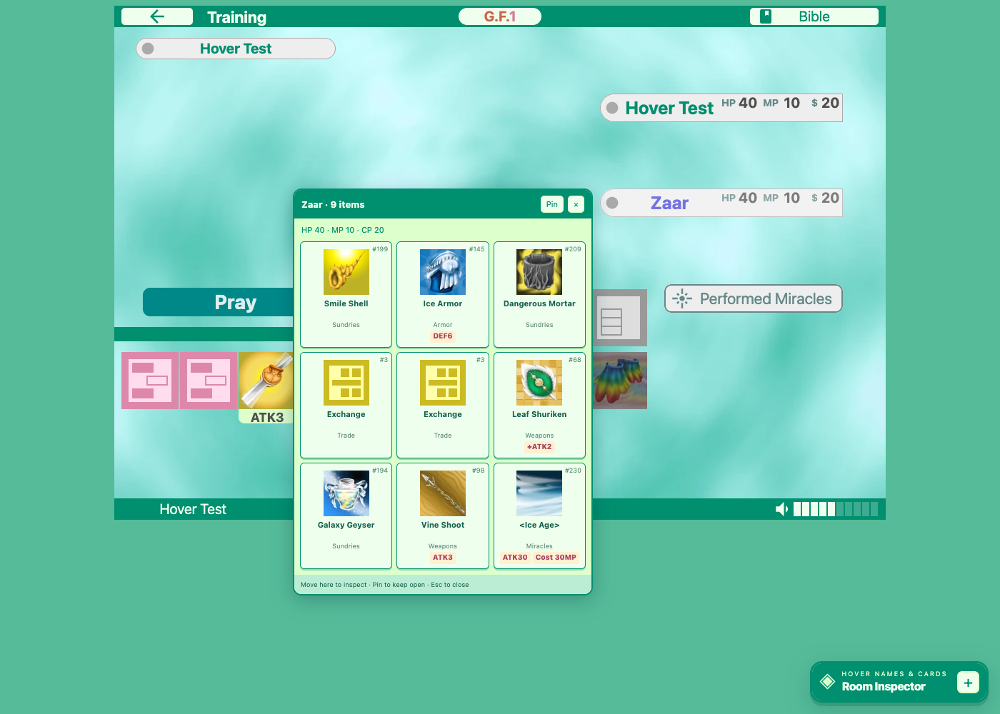

# God Field Room Inspector

[](https://github.com/BrandenXia/godfield-expose/actions/workflows/ci.yml)

A Chrome/Edge Manifest V3 extension and Tampermonkey userscript that display player inventories present in the God Field room snapshots your tab already receives. They show a God Field-style grid of original item images, translated names and stats, model IDs, fake-item display IDs, and unavailable/concealed items.

**Verified:** in a controlled private match, two separate test clients received identical full nine-item hands for both players. Training mode also exposed the opposing bot's hand. Ranked duels were not tested.

The current public client deserializes `room.game.players[].items[]` from a shared Firestore room document. See [the investigation](docs/investigation.md) for evidence and verification limits. The extension cannot recover IDs the server does not send.


## Install

Choose either the extension or the userscript for a tab.

### Chrome/Edge extension

Download the extension ZIP from [Releases](https://github.com/BrandenXia/godfield-expose/releases/latest) and extract it, or clone this repository.

1. Open Chrome's extensions page (`chrome://extensions`) or Edge's (`edge://extensions`).
2. Enable **Developer mode**.
3. Choose **Load unpacked**, then select the extracted folder containing `manifest.json` (or this repository's `extension` folder).
4. Open or **reload** [godfield.net](https://godfield.net/) and enter a game.
5. Hover a player’s name tag to see their hand, or hover a game card to inspect it. The full inspector starts collapsed at the lower right; use **+** or **Alt+I** to open it.

**Updating an existing install:** replace the extracted extension files (or keep using this repository's `extension` folder), click **Reload** on the extension card, then reload God Field.

No build, npm install, account permissions, or background service is required. The extension runs only on `https://godfield.net/*`. For ZIP installation, extract the release ZIP and load the extracted folder containing `manifest.json`.

### Tampermonkey userscript

1. Install [Tampermonkey](https://www.tampermonkey.net/) for your browser.
2. On Chrome 138+, open Tampermonkey's extension details and enable **Allow User Scripts**. On older Chrome or Edge versions that use it, enable **Developer mode** on the browser's extensions page. Follow Tampermonkey's [userscript permission instructions](https://www.tampermonkey.net/faq.php?q=Q209) if the browser requests additional permission.
3. In Tampermonkey's **Dashboard → Settings**, set **Config mode** to **Advanced**, then set **Content Script API** to **UserScripts API Dynamic** and save. This enables the early execution needed to intercept the game's first room subscription. Tampermonkey's [Content Script API documentation](https://www.tampermonkey.net/documentation.php?q=content_script_api) explains which modes support `document-start`.
4. Open [godfield-room-inspector.user.js](https://raw.githubusercontent.com/BrandenXia/godfield-expose/main/userscript/godfield-room-inspector.user.js) and choose **Install** in Tampermonkey. If the link opens as text, create a new script in Tampermonkey, replace its contents with that file, and save.
5. Open or **reload** [godfield.net](https://godfield.net/) and enter a game. The same **Room Inspector** panel appears at the lower right.

The userscript is self-contained, runs only on `https://godfield.net/*`, and needs no build or remote script dependencies. It requests `document-start`, page-context execution (`@sandbox raw`), and no privileged userscript APIs (`@grant none`). The hook must run in the game's JavaScript context before its room listener starts; if the panel stays at “Game hook not ready,” check the settings above and reload. A browser or site policy that prevents page-context execution can prevent the hook from working.

**Updating an existing install:** reopen the userscript link and confirm the update in Tampermonkey, then reload God Field.

## Hover previews

- **Player name tags:** hover a native name tag to see that player’s items and HP/MP/CP. The preview follows the tag and updates with received room snapshots.
- **Dream items:** hover a disguised game card to compare its real item with its dream appearance, side by side. Cards with identical appearances are resolved from their own item data.
- **Keep a preview open:** move into it to inspect the cards, or select **Pin**. Select **×** or press **Esc** to dismiss it.
- **Keyboard:** tab to a player tag or card for its preview. **Alt+I** toggles the full inspector.
- **Full inspector:** select **+** at the lower right to browse every player, change the item language, or save JSON. Its cards also offer hover previews with full names.



## Item languages and artwork

**Auto** follows the official catalog that the game loads, including when the game removes `?lang` from the URL. Before that request completes, the extension uses the same URL/browser-language preference order as the game. Choose a language in the panel to override it for this tab:

English, Français, 日本語, 한국어, Português, Русский, 简体中文, 繁體中文.

All 296 item names, category labels, and stat labels come from the game's official catalogs, bundled in all eight languages. Names on disguised items are translated too. Extension controls and status messages remain in English.

The panel uses the game's mint/green palette and displays a three-column card grid (two columns on narrow screens). Item artwork loads lazily from the original `godfield.net/images/items/` URLs. A missing image shows a question mark while retaining the item name. Concealed IDs do not borrow the disguise's image or imply a known real item. Hover or focus a card for a preview with its full name.

## Reading the panel

- Item name and `#ID`: the received **real `modelId`**, resolved against the selected official language catalog.
- **Displayed as**: the received `fakeModelId` used by the game to present a disguised item.
- **Unknown / concealed item**: no positive real model ID was provided. The extension does not infer one from the fake ID.
- **Unmapped item**: the server provided an ID missing from the bundled catalog.
- **Unavailable**: the snapshot omitted that player's item array. This is different from an empty inventory.
- **Cached, may be stale**: Firestore supplied a cached snapshot.
- **Save JSON**: explicitly download the currently displayed normalized snapshot. Account IDs, private room codes, and chat are excluded.

All players are shown, including you. Player IDs are game-local indices; the extension deliberately does not capture account IDs to identify your row. The last snapshot remains visible after a game ends and is cleared on leaving the room. Reloading the tab clears all extension state.

## How it works

`hook.js` observes the existing Firebase room listener in the page's MAIN world. `snapshot.js` copies only the required game fields. The isolated `panel.js` renders these fields in a shadow DOM panel. The extension makes no extra database requests, modifies no game data, and has no telemetry or automatic storage. Bundled catalogs supply 296 item names in eight languages without additional catalog requests. `locale-hook.js` observes successful game catalog fetches without reading response bodies or changing the returned promise. Original item images load from God Field as needed; the extension never sends inventory snapshots to another service.

The userscript bundles the same source files and catalogs into one file. Its hook and shadow DOM panel both run in the page's MAIN world; the extension retains its isolated panel.

`targets.js` associates native player tags and cards with their Dart view data; `hover.js` validates those associations against the received snapshot and renders previews. It does not identify cards by their image or screen order. This adapter depends on the current compiled client’s view layout; if a site update breaks native hover previews, the full inspector remains available.

The hook depends on the public `window.firebase` bridge and current room schema. It is not compatible with native mobile apps. If the panel stays at “Game hook not ready,” enable the extension before reloading. If it reports an unrecognized format, the site's schema may have changed. If opponents show unknown items, their real IDs were not received; this is not an installation error.

## Development

Use Node.js 22+ and Python 3. The installed extension has no npm dependencies.

Run the dependency-free unit tests:

```sh
npm test
```

Run the real-browser integration tests (use local fixtures, not live matches):

```sh
npm ci
npx playwright install chromium
npm run test:browser
```

The browser tests load the unpacked extension into a temporary Chromium profile and delete that profile afterward. They check both JavaScript worlds, UI behavior, and exports. Screenshots are in `test-results/inspector.png` and `test-results/inspector-mobile.png`. They also check all eight languages, automatic locale changes, manual overrides, successful image loading, and broken-image fallback. Hover tests cover native player/card association, duplicate names, identical dream appearances, reordered cards, pinning, keyboard access, live updates, stale data, click passthrough, room cleanup, and narrow-screen positioning. Hover screenshots are saved alongside the panel screenshots.

Run the same browser checks against the generated userscript, or run the extension and userscript suites in sequence:

```sh
npm run test:browser:userscript
npm run test:browser:all
```

The userscript checks inject the generated file into the page before the fixture's first script runs. They verify the payload's page-context behavior; they do not install Tampermonkey or validate its permissions and injection settings. Userscript screenshots are in `test-results/inspector-userscript.png` and `test-results/inspector-mobile-userscript.png`.

After changing shared files in `extension/`, regenerate the committed userscript with Python 3:

```sh
npm run build:userscript
npm run check:userscript
```

The check fails if `userscript/godfield-room-inspector.user.js` differs from the generated output. Edit the shared sources rather than the generated file.

Create an installable ZIP and userscript with Python 3:

```sh
npm run package
```

The ZIP contains only extension files; `dist/godfield-room-inspector.user.js` is the standalone userscript. Tests and research notes remain in the repository. The catalogs are sourced from God Field's public localization files and retain their original one-based ordering. To refresh, download all eight `/i18n/<language>.json` files into a directory, then run `python3 scripts/build-catalog.py /path/to/catalogs`. The generator checks that item counts and image/category identities align across languages before writing `extension/catalog.js`. Review changes against the current client before replacing it.

## Project files

- `extension/`: unpacked browser extension.
- `userscript/`: generated, installable Tampermonkey userscript.
- `tests/`: unit tests and offline sprite fixtures.
- `scripts/`: browser checks, catalog/userscript generation, and release packaging.
- `docs/`: investigation notes and a curated preview.

Generated ZIPs, test screenshots, browser profiles, and local captures are excluded from Git.

## Attribution

This is an unofficial project. Item data, translations, and artwork originate from God Field; see [third-party notices](THIRD_PARTY_NOTICES.md).
