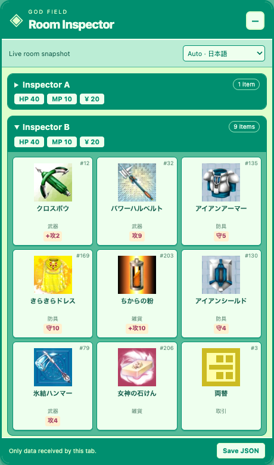

# God Field Room Inspector

[](https://github.com/BrandenXia/godfield-expose/actions/workflows/ci.yml)

A Chrome/Edge Manifest V3 extension that displays player inventories present in the God Field room snapshots your tab already receives. It shows a God Field-style grid of original item images, translated names and stats, model IDs, fake-item display IDs, and unavailable/concealed items.

**Verified:** in a controlled private match, two separate test clients received identical full nine-item hands for both players. Training mode also exposed the opposing bot's hand. Ranked duels were not tested.

The current public client deserializes `room.game.players[].items[]` from a shared Firestore room document. See [the investigation](docs/investigation.md) for evidence and verification limits. The extension cannot recover IDs the server does not send.



## Install

Download the extension ZIP from [Releases](https://github.com/BrandenXia/godfield-expose/releases/latest) and extract it, or clone this repository.

1. Open Chrome's extensions page (`chrome://extensions`) or Edge's (`edge://extensions`).
2. Enable **Developer mode**.
3. Choose **Load unpacked**, then select the extracted folder containing `manifest.json` (or this repository's `extension` folder).
4. Open or **reload** [godfield.net](https://godfield.net/) and enter a game.
5. Expand a player's row in **Room Inspector**, at the lower right. Use **−** to collapse the panel when it covers game controls.

**Updating an existing install:** replace the extracted extension files (or keep using this repository's `extension` folder), click **Reload** on the extension card, then reload God Field.

No build, npm install, account permissions, or background service is required. The extension runs only on `https://godfield.net/*`. For ZIP installation, extract the release ZIP and load the extracted folder containing `manifest.json`.

## Item languages and artwork

**Auto** follows the official catalog that the game loads, including when the game removes `?lang` from the URL. Before that request completes, the extension uses the same URL/browser-language preference order as the game. Choose a language in the panel to override it for this tab:

English, Français, 日本語, 한국어, Português, Русский, 简体中文, 繁體中文.

All 296 item names, category labels, and stat labels come from the game's official catalogs, bundled in all eight languages. Names on disguised items are translated too. Extension controls and status messages remain in English.

The panel uses the game's mint/green palette and displays a three-column card grid (two columns on narrow screens). Item artwork loads lazily from the original `godfield.net/images/items/` URLs. A missing image shows a question mark while retaining the item name. Concealed IDs do not borrow the disguise's image or imply a known real item. Hover a card for its full name if it is truncated.

## Reading the panel

- Item name and `#ID`: the received **real `modelId`**, resolved against the selected official language catalog.
- **Displayed as**: the received `fakeModelId` used by the game to present a disguised item.
- **Unknown / concealed item**: no positive real model ID was provided. The extension does not infer one from the fake ID.
- **Unmapped item**: the server provided an ID missing from the bundled catalog.
- **Unavailable**: the snapshot omitted that player's item array. This is different from an empty inventory.
- **Cached, may be stale**: Firestore supplied a cached snapshot.
- **Save JSON**: explicitly download the currently displayed normalized snapshot. Account IDs, private room codes, and chat are excluded.

All players are shown, including you. Player IDs are game-local indices; the extension deliberately does not capture account IDs to identify your row. The last snapshot remains visible after a game ends and is cleared on leaving the room. Reloading the tab clears all extension state.

## How it works

`hook.js` observes the existing Firebase room listener in the page's MAIN world. `snapshot.js` copies only the required game fields. The isolated `panel.js` renders these fields in a shadow DOM panel. The extension makes no extra database requests, modifies no game data, and has no telemetry or automatic storage. Bundled catalogs supply 296 item names in eight languages without additional catalog requests. `locale-hook.js` observes successful game catalog fetches without reading response bodies or changing the returned promise. Original item images load from God Field as needed; the extension never sends inventory snapshots to another service.

The hook depends on the public `window.firebase` bridge and current room schema. It is not compatible with native mobile apps. If the panel stays at “Game hook not ready,” enable the extension before reloading. If it reports an unrecognized format, the site's schema may have changed. If opponents show unknown items, their real IDs were not received; this is not an installation error.

## Development

Use Node.js 22+ and Python 3. The installed extension has no npm dependencies.

Run the dependency-free unit tests:

```sh
npm test
```

Run the real-browser integration test (uses a local fixture, not a live match):

```sh
npm ci
npx playwright install chromium
npm run test:browser
```

The browser test loads the unpacked extension into a temporary Chromium profile and deletes that profile afterward. It checks both JavaScript worlds, UI behavior, and exports. Screenshots are in `test-results/inspector.png` and `test-results/inspector-mobile.png`. It also checks all eight languages, automatic locale changes, manual overrides, successful image loading, and broken-image fallback.

Create an installable ZIP with Python 3:

```sh
npm run package
```

The ZIP contains only extension files; tests and research notes remain in the repository. The catalogs are sourced from God Field's public localization files and retain their original one-based ordering. To refresh, download all eight `/i18n/<language>.json` files into a directory, then run `python3 scripts/build-catalog.py /path/to/catalogs`. The generator checks that item counts and image/category identities align across languages before writing `extension/catalog.js`. Review changes against the current client before replacing it.

## Project files

- `extension/`: unpacked browser extension.
- `tests/`: unit tests and offline sprite fixtures.
- `scripts/`: browser checks, catalog generation, and ZIP packaging.
- `docs/`: investigation notes and a curated preview.

Generated ZIPs, test screenshots, browser profiles, and local captures are excluded from Git.

## Attribution

This is an unofficial project. Item data, translations, and artwork originate from God Field; see [third-party notices](THIRD_PARTY_NOTICES.md).
